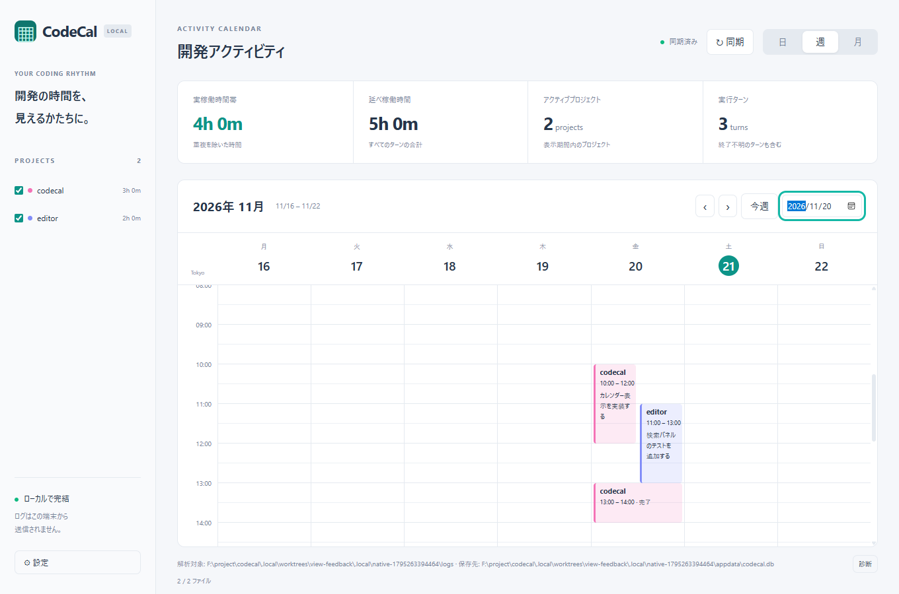
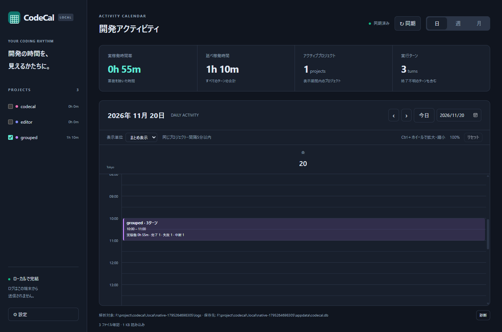

# CodeCal

Codex CLI / Codex デスクトップと「れい」のローカル実行履歴を読み取り、プロジェクトごとの活動時間をカレンダーで振り返るアプリです。開発以外の実行も含め、開始・終了が記録された時間を集計します。Windows・macOS・Linux向けに開発しています。ログの外部送信やテレメトリーはありません。

## 画面例

以下は合成ログを読み込んだ実際のTauriアプリです。

### 週表示

### 月表示

### 日表示（まとめ表示）

## はじめる

### 1. ダウンロード・インストール

[Releases](https://github.com/mikoto2000/codecal/releases) から、お使いのOSとCPUに合ったファイルを選びます。x64はIntel / AMDの64ビットCPU、ARM64はApple SiliconなどのARMの64ビットCPU向けです。

| OS      | 選ぶファイル                                                                           | インストール方法                                              |
| ------- | -------------------------------------------------------------------------------------- | ------------------------------------------------------------- |
| Windows | `CodeCal_<version>_windows_x64-setup.exe` または `windows_arm64-setup.exe`             | インストーラーを実行し、スタートメニューから起動              |
| macOS   | `CodeCal_<version>_macos_x64.dmg` または `macos_arm64.dmg`                             | DMGを開き、CodeCalをApplicationsへコピーして起動              |
| Linux   | `CodeCal_<version>_linux_x64.deb` / `.AppImage` または `linux_arm64.deb` / `.AppImage` | Debian系ではdebをインストール。AppImageは実行権限を付けて起動 |

公開済みのリリースがない場合は、[開発ガイド](DEVELOPMENT.md)の手順でソースから実行できます。

WindowsではMicrosoft Edge WebView2 Runtimeが必要です。LinuxではWebKitGTK 4.1などの実行時依存が必要で、debは依存パッケージを解決できるパッケージ管理ツールからインストールしてください。

Windowsのインストーラーは未署名、macOSはアドホック署名でDeveloper ID署名・公証は未設定です。起動・操作の検証はWindows 11 x64で行っており、macOS・LinuxとWindows ARM64の実機での起動・操作は未検証です。

### 2. ログの取り込みを確認する

1. CodeCalを起動すると、ローカルのCodexログの取り込みが始まります。通常はログインや接続設定は不要です。
2. 既定では `CODEX_HOME`、未設定ならホームディレクトリの `.codex` を参照します。画面下部に対象ディレクトリと保存先が表示されます。
3. ログが別の場所にある場合は、「設定」のログディレクトリを変更します。Codexホーム、またはセッションログ（JSONL）を保存した専用ディレクトリを指定してください。
4. 「同期」を押し、左側のプロジェクト一覧とカレンダーに作業が表示されることを確認します。設定でタイムゾーンも確認してください。

Codexホームを指定した場合、`sessions` と `archived_sessions` のログを読み込みます。初回の取り込みはログ量に応じて時間がかかります。

「れい」は「設定」の「れいの実行履歴を取り込む」で有効・無効を切り替えます。既定のデータディレクトリが存在する場合は自動的に有効になります。保存先は `REI_DATA_DIR` を優先し、未設定ならWindowsは `%LOCALAPPDATA%/Rei`、macOSは `~/Library/Application Support/Rei`、Linuxは `${XDG_DATA_HOME:-~/.local/share}/rei` です。起動オプションなどで別の保存先を使っている場合は設定で指定してください。

指定先の `storage.db`（SQLite、WALを含む）と、旧形式の `projects/<projectId>/events/events.jsonl` を読み取り専用で参照します。`storage.db` と `projects` ディレクトリのどちらも見つからない場合は、設定保存時と同期時に警告します。初回案内に有効状態を表示し、設定から無効にできます。同じイベントが両方にあっても二重計上しません。同じ作業ディレクトリならCodexと同じプロジェクトへ集約し、詳細で取得元を確認できます。接続・認証設定や「れい」の起動は不要です。

### 3. カレンダーで作業を振り返る

| 表示 | できること                                                                                                             |
| ---- | ---------------------------------------------------------------------------------------------------------------------- |
| 日   | 選択日のタイムラインを表示。「前へ」「次へ」で日送り、Ctrl＋ホイールで拡大・縮小（50〜400%）。「リセット」で100%に戻す |
| 週   | 1週間の時間の使い方を比較。日付入力や前後移動、「今週」で期間を変更                                                    |
| 月   | 日ごとの稼働時間を濃淡で確認。日付をクリックして作業一覧を開き、日・週表示へ移動                                       |

左側のプロジェクトのチェックを外すと、表示と集計を絞れます。重複する作業はタイムライン上に横並びで表示されます。

## 作業ブロックと稼働時間の見方

日・週表示は「まとめ表示」が既定です。同じプロジェクトで、重複または間隔5分以内の作業を1つのブロックにまとめます。「表示単位」でターン単位にも切り替えられます。空白の5分間を稼働時間に加算することはありません。

ブロックをクリックすると、元のターンごとの依頼文・状態・日時・トークンなどを確認できます。「ログの該当箇所を表示」では元のローカルログを読みます。依頼文などの機密情報が表示されることがあるため、画面共有時には注意してください。

- **実稼働時間帯**：並列作業の重複を除いた時間です。
- **延べ稼働時間**：各ターンの時間の合計です。並列作業があると実稼働時間帯より長くなります。日別のプロジェクト時間は延べ時間です。
- **終了不明**：開始・終了が揃わない作業です。現在まで稼働したとは推測せず、短いマーカーで表示します。「実行中」と「異常終了」の区別はできません。

## 設定と自動更新

「設定」でタイムゾーン（例：`Asia/Tokyo`）、週の開始曜日、テーマ、自動更新、カレンダーの濃淡、プロジェクト名と色を変更できます。タイムゾーンを変えると、その地域の日付で再集計します。

存在しないログディレクトリも保存できますが、設定画面に警告を表示します。パスを修正するか、ディレクトリを用意してから同期してください。再起動後も取り込めない場合は画面の警告から設定・診断を確認できます。

自動更新が有効な場合はログの変更を取り込みます。すぐに反映したいときは「同期」を押してください。ビューや日付の切り替え中はスピナーを表示します。

ウィンドウの位置・サイズ・最大化状態は通常終了時に保存し、次回起動で復元します。

## データの保存場所

元のCodexログや「れい」のデータは変更せず、取り込んだ履歴をこの端末の `codecal.db` に保存します。実際の絶対パスは設定画面で確認できます。

| OS      | 既定の保存先                                                      |
| ------- | ----------------------------------------------------------------- |
| Windows | `%LOCALAPPDATA%\dev.codecal.desktop\codecal.db`                   |
| macOS   | `~/Library/Application Support/dev.codecal.desktop/codecal.db`    |
| Linux   | `${XDG_DATA_HOME:-~/.local/share}/dev.codecal.desktop/codecal.db` |

ウィンドウ状態の `window-state.json` も同じディレクトリに保存します。Windowsの旧Roaming保存先にDBがあり、Local側が未作成の場合は自動移行します。旧DBは残り、既存Local DBは上書きしません。

バックアップやDBの削除は、アプリを閉じてから行ってください。元のログを削除したりログディレクトリを変更したりしても、取り込み済みの履歴は保持します。

## 困ったとき

- **何も表示されない**：設定のログディレクトリとタイムゾーン、表示中の日付、プロジェクトのチェックを確認し、「同期」を押してください。
- **ログの一部が取り込まれない**：「診断」で対象ファイルとエラーを確認してください。書き込み途中の行は次回の同期まで待機します。未対応のログ形式や大きすぎる行は取り込めない場合があります。
- **時間が想定より短い**：終了不明の作業は時間に含みません。重複を除いた「実稼働時間帯」と、合計の「延べ稼働時間」の違いも確認してください。
- **履歴が多く動作が重い**：初回取り込みや長期間の再集計に時間がかかることがあります。現在、非常に長い履歴の表示には制限があります。

不具合は [Issues](https://github.com/mikoto2000/codecal/issues) へ報告できます。OS・CPU、アプリのバージョン、再現手順と診断内容を添えてください。ログやスクリーンショットを添付する際は、依頼文や個人情報を除いてください。

## 開発・ライセンス

開発環境の準備、ソースからの実行、テスト、ビルド、設計資料は [DEVELOPMENT.md](DEVELOPMENT.md) を参照してください。

[MITライセンス](LICENSE)で公開しています。
