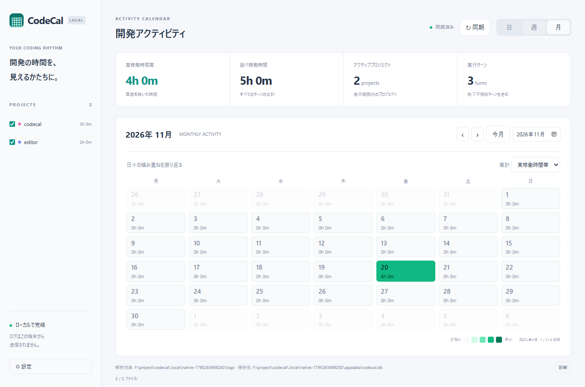
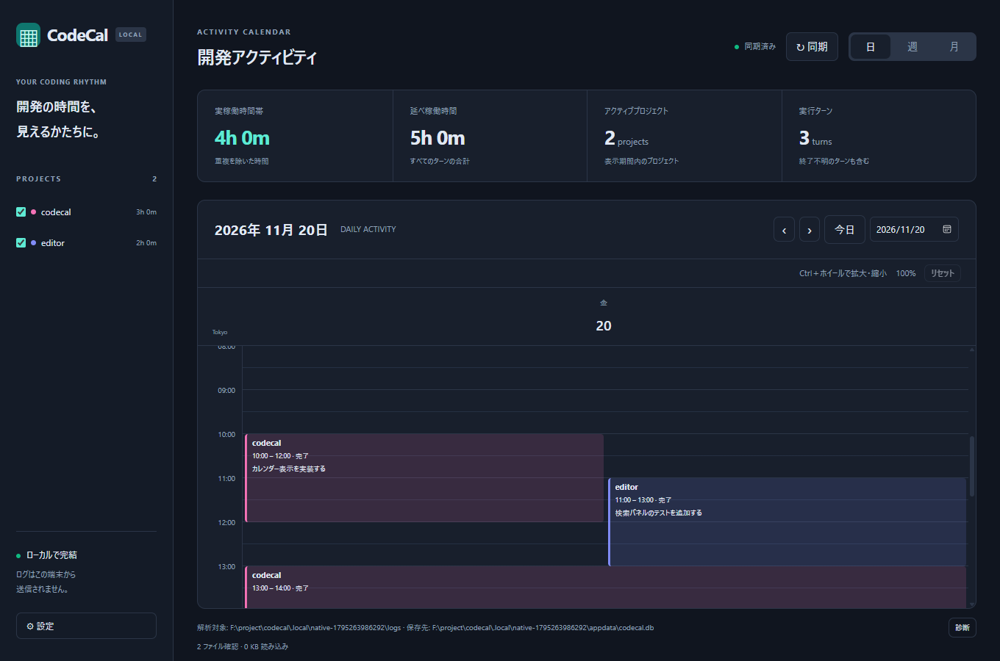

# CodeCal

Codex CLI / Codex デスクトップのローカルセッションログから、プロジェクトごとの開発時間を振り返る Windows 11 向けアプリです。React / TypeScript / Vite / Tailwind CSS と Tauri 2 / Rust / SQLite で構成しています。ログの外部送信、テレメトリー、任意コマンド実行機能はありません。






スクリーンショットは合成ログを読み込んだ実際のTauriアプリです。画像は `docs/screenshots/` に保存しています。

## インストール・起動

Windows 11 x64 と Microsoft Edge WebView2 Runtime が必要です。生成した `src-tauri/target/release/bundle/nsis/CodeCal_0.1.0_x64-setup.exe` を実行し、スタートメニューから CodeCal を起動してください。インストールせず `src-tauri/target/release/codecal.exe` を直接起動することもできます。インストーラーは未署名です。

起動すると対象ディレクトリと保存先が画面下部に表示され、ログの取り込みが始まります。既定では `CODEX_HOME`、未設定ならユーザーホームの `.codex` を参照します。ホーム内の `sessions` と `archived_sessions` が対象です。「設定」のログディレクトリには Codex ホームまたは JSONL を含む専用ディレクトリを指定できます。

データベースは Tauri のユーザー別ローカルアプリデータディレクトリ `dev.codecal.desktop/codecal.db` に保存します。設定画面に絶対パスを表示します。 Windowsの既定は `%LOCALAPPDATA%\dev.codecal.desktop\codecal.db`（通常 `C:\Users\<ユーザー名>\AppData\Local\dev.codecal.desktop\codecal.db`）です。以前のRoaming保存先にDBがあり、Local側が未作成の場合は、初回起動でSQLiteの整合したスナップショットを自動移行します。旧DBは残し、既存Local DBは上書きしません。 macOSでは `~/Library/Application Support/dev.codecal.desktop/codecal.db`、Linuxでは `${XDG_DATA_HOME:-~/.local/share}/dev.codecal.desktop/codecal.db` が既定です（両OSの起動は未検証）。環境変数 `CODECAL_DATA_DIR` で保存先を変更でき、合成ログによる検証や持ち運び用データの隔離にも利用できます。

## 使い方

- 日表示: 「日」で選択日のみを表示。「前へ」「次へ」は1日ずつ移動し、「今日」で当日に戻ります。月の日別詳細から「1日表示で開く」でも移動できます。タイムライン上でCtrl＋ホイール上回転は拡大、下回転は縮小（50〜400%）。マウス位置の時刻を保ち、「リセット」で100%へ戻せます。起動中はビューを切り替えても日表示の倍率を保持します。

- 週表示: 日付入力、前後移動、「今週」で対象期間を選択。時刻軸をスクロールできます。重複した作業は横並びになります。左側のプロジェクトを外すと表示と集計を絞れます。
- 作業をクリックすると依頼文・ID・状態・トークン・日時を確認できます。「ログの該当箇所を表示」はローカルログを最大64KiB読みます。機密情報を含み得るため、画面共有時には注意してください。
- 月表示: 月を選択してヒートマップを確認。日付は月曜から日曜へ横に進み、翌週は次の行に並びます（開始曜日は設定に従います）。セルをクリックすると日別集計と作業一覧が開き、「週表示で開く」で移動します。集計方式を実稼働時間帯 / 延べ稼働時間に切り替えられます。
- 日・週・月の切り替えと日付移動の間はスピナーを表示します。日別集計はキャッシュし、月の各セルで履歴全体を再計算しません。
- 設定: IANAタイムゾーン（例 `Asia/Tokyo`）、週の開始曜日、テーマ、自動更新、濃淡のしきい値、プロジェクト名と色を変更できます。タイムゾーンを変えると再集計します。
- 自動更新はファイル監視と30秒の補完走査を使用します。「同期」で手動更新できます。取り込みの不備は「診断」で確認できます。

## 開発環境

Node.js 24、Rust stable MSVC、Visual Studio C++ Build Tools、Windows SDK、WebView2 が必要です。具体的な前提は [Tauri公式のWindows要件](https://v2.tauri.app/start/prerequisites/) を参照してください。

```powershell
npm ci
npm run tauri dev
```

`npm run dev` はフロントエンドのみを起動します。ログ取り込みには Tauri IPC が必要なので、通常のブラウザーだけではデータを読み込めません。

## テストとビルド

```powershell
npm run typecheck
npm run lint
npm run format:check
npm test
cargo fmt --manifest-path src-tauri/Cargo.toml --check
cargo clippy --manifest-path src-tauri/Cargo.toml --all-targets -- -D warnings
cargo test --manifest-path src-tauri/Cargo.toml --all-targets
npm run build
npm run tauri build
npm run test:e2e
```

E2EはWindowsの実行ファイルとWebView2に直接接続します。ビルドを先に実行してください。使用する9223番ポートを空け、ほかのネイティブE2Eと同時実行しないでください。Rustコアのみは `cargo test --manifest-path src-tauri/Cargo.toml --no-default-features` で確認できます。

合成ログを試す場合は `node scripts/create-sample.mjs` を実行し、設定で `.local/sample-codex` の絶対パスを指定してください。既存ファイルは上書きしません。

## 稼働時間の定義

開始・終了イベントが対応するターンだけを時間集計します。延べ稼働時間は各ターンの時間の合計、実稼働時間帯は重複を統合した時間です。未終了ターンは「終了不明」の短いマーカーとして表示し、現在まで稼働したと推測しません。UTCで保存し、指定タイムゾーンの日付境界で日別に按分します。日別プロジェクト時間は延べ時間です。

## 既知の制限

- 未終了ログから「実行中」と「異常終了」を区別できないため、いずれも終了不明にします。旧形式のセッション全体トークン累積値からターン使用量を推測しません。
- 1MiBを超える行は診断してスキップ、末尾の改行前の行は次の同期まで待機します。依頼文の保存は16Ki文字までです。
- 同期後の派生テーブルは正規化イベントから再構築します。元ファイルは増分読み取りですが、非常に長い履歴の再集計・全ターンのUI転送には今後ページングが必要です。
- ファイル識別には作成時刻、更新時刻、長さ、先頭最大4KiBのハッシュを使います。作成時刻・先頭を維持したまま既存の中間部分を書き換え、同時に追記する特殊な変更は検出できない場合があります。通常の追記・置換・切り詰め・移動は対応しています。
- 取り込み済みファイルを外部で削除した場合、過去の稼働記録は保持します。ログディレクトリ変更でも既存の履歴を保持します。DBを消す場合はアプリを閉じ、保存先をバックアップしてから手動で管理してください。
- ターンの結合表示は未実装です。各ターンを独立して保持・表示します。終了イベントしかないターンは開始時刻を推測して作成しません。
- 夏時間の日は実経過時間に合わせて列内の時刻目盛りを個別表示します。通常日の共通時刻軸とは位置が異なります。
- Windows x64で検証しています。Linux / macOSのネイティブ起動・パッケージと、クリーンな別端末でのインストールは未検証です。

設計と検証の詳細は [architecture](docs/architecture.md)、[ログ形式](docs/codex-log-format.md)、[稼働計算](docs/activity-calculation.md)、[DB](docs/database-schema.md)、[開発](docs/development.md)、[テスト](docs/testing.md) を参照してください。
